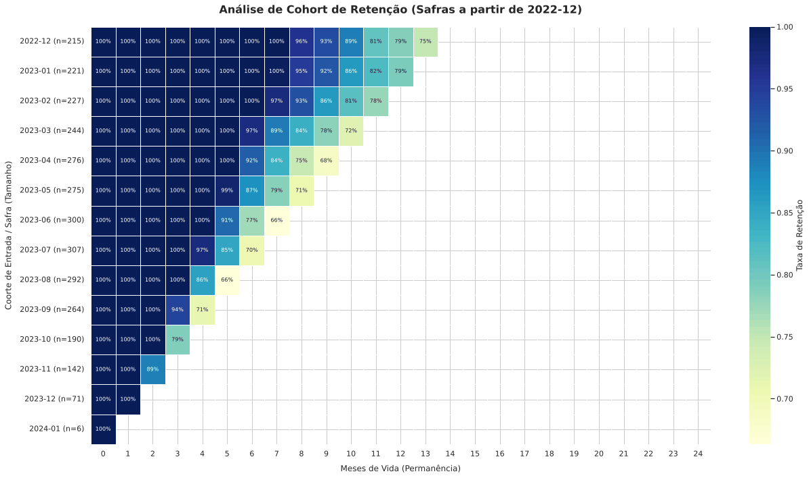

# Análise Exploratória de Churn — Plataforma de Streaming

**Preço é o motivo nº 1 de cancelamento. Mas quem paga menos é quem mais cancela.**

A diretoria queria entender por que o cancelamento piorou. A explicação mais citada pelos
próprios clientes aponta para o preço — e os dados sugerem que ela está errada.

| | |
|---|---|
| **25 pontos** | é a queda de retenção entre quem entrou em dez/22 e em mai/23, medida no mesmo 8º mês de vida |
| **59%** | dos cancelamentos se concentram em apenas dois motivos |
| **12%** | da base chegou com erro de escala no valor da mensalidade |

5.025 assinantes · exportados às pressas de três sistemas diferentes · nenhum modelo preditivo

📓 **[Abrir o notebook](notebooks/01-analise-exploratoria-churn.ipynb)** ·
[Executar no Colab](https://colab.research.google.com/github/brenno-azevedo/streaming_churn/blob/master/notebooks/01-analise-exploratoria-churn.ipynb)



<sub>Cada linha é um grupo que entrou no mesmo mês. As células em branco não são retenção zero — são o fim da janela de observação.</sub>

---

## 💼 O problema

A diretoria de uma plataforma de cursos por assinatura desconfia que o cancelamento
piorou, e ninguém sabe explicar por quê. Foi entregue um extrato de 5.025 clientes,
exportado às pressas de três sistemas diferentes — portanto com inconsistências reais.

Antes de perguntar "que modelo usar", a pergunta é mais básica: **o que existe nesse
dado, o que está errado nele, e o que ele já responde sem modelagem nenhuma.**

## 📈 Principais achados

Preço (33,6%) e pouco conteúdo novo (25,4%) somam 59% dos cancelamentos. São duas frentes com donos diferentes: precisamos revisar a proposta de valor do plano de entrada com o time comercial e ajustar a quantidade de conteúdo entregue com o time de produto.

A coorte mostra o que a taxa de churn global esconde: quem entrou em dezembro/22 chegou ao 8º mês com 96% de retenção, enquanto quem entrou em maio/23 chegou com 71%. Mesmo momento de vida, 25 pontos a menos em cinco meses de diferença na entrada. As taxas por canal são parecidas (de 22,7% a 27,1%), o que torna menos provável que a explicação esteja na aquisição. Precisamos separar as duas hipóteses: piorou o produto ou piorou a qualidade de quem estamos trazendo.

Já sobre a conversão, o funil mostra um gargalo entre quem assistiu a 1ª aula e quem assinou o plano: a conversão cai para 39,5%, contra 67,5% e 79,9% das etapas anteriores. O funil aponta onde perdemos, não o porquê — mas a queda acontece justamente na hora de pagar, o que conversa com o preço sendo o motivo nº 1 de cancelamento.

Por fim, um dado que contraria a leitura óbvia do Pareto: se preço fosse o problema, o premium cancelaria mais — mas quem lidera é o básico, com 27,3% contra 21,4%. O ciclo de cobrança não muda nada (mensal 24,3%, anual 24,1%), o que reforça a hipótese. Antes de mexer no preço, precisamos entender por que o plano de entrada não sustenta valor.

## ⚠️ Limitações

Esta análise mostra o que aconteceu, não o que vai acontecer se mudarmos alguma coisa. Saber que preço é o motivo mais citado não garante que baixar o preço reduziria os cancelamentos. Para afirmar isso, seria preciso testar na prática — um grupo recebendo a mudança e outro não, para comparar.

O motivo do cancelamento é o que o cliente escolheu numa lista. E preço é sempre a resposta mais fácil de marcar. Quem simplesmente parou de usar dificilmente vai admitir isso num formulário, então o peso do preço pode estar maior do que o problema real. O achado sobre o plano básico aponta justamente nessa direção.

O arquivo do funil diz quem passou por cada etapa, mas não diz quando. A ordem das etapas foi assumida porque faz sentido para o negócio, não porque os dados comprovam. Também não dá para saber quanto tempo a pessoa demora entre uma etapa e outra.

Sobre o uso da plataforma, só temos números totais. Sabemos quantas horas cada pessoa assistiu no acumulado, mas não se ela foi assistindo cada vez menos antes de cancelar. É esse histórico que confirmaria — ou derrubaria — a hipótese do plano de entrada.

Os dados são uma foto de um único dia (31/01/2024) e foram criados para fins de estudo. Quem entrou há pouco tempo quase não teve chance de aparecer como cancelamento, e os padrões aqui podem não se repetir numa base real.

## 🚧 Próximos passos

Agir agora sobre quem está em risco. O RFM identificou 708 clientes ativos (20,6% da base) que já foram frequentes e andam sumidos. Esses ainda não cancelaram, então é o único grupo em que dá para agir de forma preventiva com o que já temos em mãos.

Pedir o histórico de acesso com data. Hoje sabemos o total de horas que cada pessoa assistiu, mas não como isso evoluiu. Com o registro mês a mês dá para ver se o uso foi caindo antes do cancelamento — e é isso que confirma ou derruba a hipótese de que o plano de entrada não entrega valor suficiente.

Conversar com quem parou na hora de assinar. O funil mostra onde a perda acontece, mas nenhum dado vai dizer o porquê. Algumas entrevistas com quem assistiu a primeira aula e não assinou resolvem em uma semana o que a base não responde.

Testar antes de aplicar em todo mundo. Qualquer mudança no plano de entrada — preço, quantidade de conteúdo, formato — deve valer primeiro para uma parte dos clientes, mantendo o resto como comparação. É a única forma de saber se o resultado veio da mudança ou foi coincidência.

---

## 🔍 O que foi feito

| Etapa | Conteúdo |
|---|---|
| **Análise univariada** | Tipos, valores ausentes, cardinalidade, padronização de categorias e deduplicação |
| **Saneamento** | Consistência lógica entre as quatro colunas de data e tratamento de outliers por tipo |
| **Engenharia de atributos** | Criação de `recencia`, `meses_assinatura` e `receita_acumulada` |
| **Análise bivariada** | Relação de cada variável com o churn, sobre base filtrada por maturidade mínima |
| **Frameworks de decisão** | Coorte de retenção, RFM adaptado, Pareto dos motivos e funil de onboarding |

## 🧹 O que o dado tinha de errado

| Problema | Escala |
|---|---|
| Grafias inconsistentes em `plano` | 8 grafias para 3 planos |
| Grafias inconsistentes em `canal_aquisicao` | 9 grafias para 4 canais |
| Valor curinga `"?"` em `regiao` | 170 registros |
| Erro de escala em `valor_mensal` | 596 registros (~12% da base) |
| Idades impossíveis (−2, 0, 1, 150, 300) | 13 registros |
| Último acesso anterior à assinatura | 1 registro |
| Clientes duplicados | 25 `cliente_id` repetidos |

> **Detalhe que vale registrar:** as duplicatas só ficam visíveis **depois** de padronizar
> as grafias. Antes disso, `duplicated()` encontra apenas 1 linha, porque `"Padrao"` e
> `"Padrão"` não batem como texto. A ordem das etapas de limpeza muda o resultado.

## 📁 Estrutura do projeto

```
├── README.md
├── requirements.txt
├── notebooks/
│   └── 01-analise-exploratoria-churn.ipynb
├── src/
│   └── exec_univariado.py      # pipeline de limpeza reutilizável
└── reports/
    └── figures/
```

## 🔁 Como reproduzir

O notebook lê os dados diretamente do repositório público da instituição, então **roda
sem nenhuma configuração**. Basta abrir no Colab pelo botão acima e executar tudo.

Para rodar localmente:

```bash
git clone https://github.com/brenno-azevedo/streaming_churn.git
cd streaming_churn
pip install -r requirements.txt
jupyter notebook notebooks/01-analise-exploratoria-churn.ipynb
```

Ou usar só o pipeline de limpeza:

```python
from src.exec_univariado import executar_pipeline
df = executar_pipeline()
```

## 🔒 Sobre os dados

A base é **sintética**, fornecida pelo curso para fins didáticos, e **não é versionada
neste repositório** — o `.gitignore` bloqueia `*.csv` deliberadamente. O notebook lê os
arquivos da fonte pública original, o que mantém a análise reprodutível sem publicar
dado algum aqui.

Nenhuma informação real de cliente é usada ou distribuída neste projeto.

---

Projeto da disciplina *Dados, IA e Negócio* — Pós-graduação em Data Science e IA (UNIPDS/Anhanguera).

**Brenno Azevedo** · [LinkedIn](https://www.linkedin.com/in/brenno-azevedo) · [GitHub](https://github.com/brenno-azevedo)
